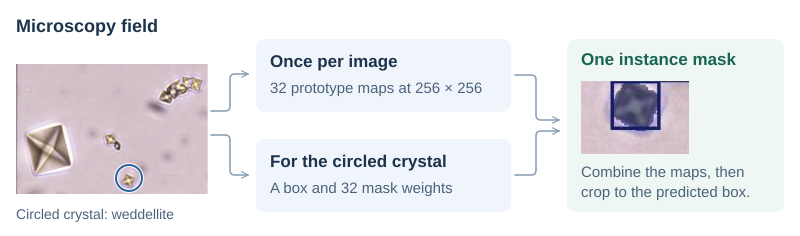

# Urinary crystal instance segmentation

A single microscopy image can contain several crystals, sometimes of different species. I fine-tuned YOLO11 segmentation models to outline each crystal and assign it a class. Medical engineers at CHU Orléans drew the polygons in CVAT. I matched those annotations to the images, resolved duplicate species labels and evaluated the models across five validation folds.

[Training notebook](notebooks/PRI_train.ipynb) · [Technical report](docs/reports/project-report.pdf)

## One microscopy field

The model labelled the large crystal on the left and a smaller one near the centre as weddellite (C2). Their displayed confidence scores were 1.0 and 0.5, respectively.

**Figure 1.** Expert polygons for seven C2 crystals (left) and predicted instance masks on the same field (right, report Figure 6.3).

The report does not identify the model, fold or checkpoint for this prediction. [Original image and expert polygons](docs/data.md#annotation-example) · [Full prediction collage](docs/media-guide.md#prediction-collage).

## Making sense of the filenames

The hospital organised the images into species folders, but a folder called `whewellite` could also contain fields with weddellite. Some filenames named both species, some recorded the lighting or pH, and others contained only a registration number. I used the hospital’s coding guide to map these variations to consistent CSV fields while keeping the original filenames and paths.

| Original filename | What I recorded |
| --- | --- |
| `C1 (+C2)_intoxication Ethylene_glycol (EG)_3.tif` | The filename identified both whewellite (C1) and weddellite (C2) in the `whewellite` folder. The row records both species, `mixture = Yes` and the abbreviation `EG`. |
| `P9130977.JPG` | The filename gave no species. I took C1 from the folder and recorded that fallback in `notes`. |
| `calcite_pH85_C8097.jpg` | I mapped calcite to CAL and decoded `pH85` as `8.5`. |

The resulting CSV has **659 rows**, one per image. The parser found multiple species codes in **78 rows** and a pH value in **65**. In **89 rows**, neither the filename nor the folder yielded a recognised species. I kept those fields empty. The experts’ polygons supplied the training labels. [Metadata CSV](metadata/image_metadata.csv) · [Parsing script](scripts/preprocessing/data_preprocessing_image_metadata.py) · [Worked examples](metadata/README.md#examples-from-the-report).

## From expert polygons to training labels

I started with **659 source images** and a CVAT export with **41 class IDs**. Some IDs referred to the same species. For example, the export listed brushite under both `brushite` and `Br_brushite`. I merged five such aliases before counting how many images contained each class.

I used classes present in at least five labelled images for the first experiment. That left **607 images and 19 classes**. For the second, I removed four more classes, updated the polygon IDs and dropped images with no remaining annotations. The final set contained **583 images, 15 classes and 7,371 annotated instances**. [Preparation stages and class mapping](docs/data.md#preparation-stages).

| IDs 0–4 | IDs 5–9 | IDs 10–14 |
| --- | --- | --- |
| **AMO** · Amoxicillin trihydrate | **C3** · Caoxite | **NASM** · N-acetylsulfamethoxazole hydrochloride |
| **AU2** · Uric acid dihydrate | **CAL** · Calcite | **PACC** · Plaque vitreuse¹ |
| **Br** · Brushite | **CYS** · Cystine | **PAM** · Struvite |
| **C1** · Whewellite | **DHAd** · Dihydroxyadenine | **UrAm** · Anhydrous ammonium urate |
| **C2** · Weddellite | **NASD** · N&#8209;acetylsulfadiazine | **VAT** · Vaterite |

¹ Original training label. [Class IDs and counts by image and instance](docs/data.md#segmentation-classes).

## How the model predicts a mask

How does the model outline the small weddellite crystal near the bottom of this field? At the 1024 px input size used here, YOLO11m-seg computes 32 maps for the whole image, called *mask prototypes*. For each crystal it detects, it predicts a bounding box and 32 weights, one per map.

**Figure 2.** The circle marks one crystal in the original field. In the enlarged crop from report Figure 6.3, the shaded pixels show the predicted mask and the rectangle shows the detection box.

At each pixel, the model multiplies the 32 prototype values by the crystal’s weights and adds them to get a mask score. It crops the result to the predicted box and resizes it to the image. A neighbouring crystal uses the same maps with its own weights, so it can have a different outline. [Feature scales and tensor dimensions](docs/architecture.md#feature-extraction-and-fusion).

## Training and validation

I initially split the 613 annotated images into 490 for training and 123 for validation. The other 46 source images had no annotations. For the 15-class experiment, I built new folds from all 583 retained images. Each field could contain several classes, so I stratified the folds using a binary vector of class presence for each image.

**Figure 3.** (a) Initial split of the source collection. (b) Each highlighted block gives the number of held-out images in one fold. The score comes from the epoch with the highest validation mask mAP50–95 in that fold.

I trained a fresh model on four groups per fold, starting from the same pretrained weights. Each image was held out exactly once. [Fold sizes and split settings](docs/data.md#trainvalidation-strategy) · [Notebook guide](notebooks/README.md).

| Model | Training set | Input and training budget | Epoch used in the summary |
| --- | --- | --- | --- |
| [YOLO11n-seg](docs/experiments.md#earlier-yolo11n-seg-result) | 607 images · 19 classes | 1024 px · batch 4 · up to 50 epochs | Last recorded epoch in each run directory |
| [YOLO11m-seg](docs/experiments.md#yolo11m-seg-per-fold-mask-metrics) | 583 images · 15 classes | 1024 px · batch 4 · up to 100 epochs | Highest validation mask mAP50–95 in each fold |

Across five folds, **YOLO11m-seg reached a mean validation mask mAP50–95 of 0.4874** (sample SD 0.0453). This metric averages per-class mask AP across classes and overlap thresholds from 0.50 to 0.95.

| Mask precision | Mask recall | Mask mAP50 | Mask mAP50–95 |
| --- | --- | --- | --- |
| 0.7022 ± 0.0335 | 0.6306 ± 0.0513 | 0.6813 ± 0.0427 | **0.4874 ± 0.0453** |

The folds were split by image. Related views of the same specimen could fall into different folds. The two experiments also used different class sets, augmentations and epoch-selection rules, which limits what their scores tell us about model size alone. [Per-fold metrics](docs/experiments.md#yolo11m-seg-per-fold-mask-metrics) · [Recorded CSV](results/recorded-fold-metrics.csv).

## Poster and presentation

| Recorded presentation · 2:17 | Project poster |
| :---: | :---: |
|  |  |
| **Figure 4.** Frame from the recorded poster presentation. | **Figure 5.** Project poster showing microscopy fields and predicted crystal masks. |

[Defence slides](docs/presentations/project-defence.pptx)

## Repository guide

| Resource | What you’ll find |
| --- | --- |
| [Notebook](notebooks/README.md) · [Execution notes](docs/reproducibility.md) | Colab preparation and training, saved outputs and paths to adapt before a rerun. |
| [Dataset](docs/data.md) · [Source export](data/README.md) · [Metadata](metadata/README.md) | Class counts, annotation format, split files and the filename fields. |
| [Architecture](docs/architecture.md) · [Experiments](docs/experiments.md) · [Result tables](results/README.md) | The segmentation head, training settings and how each fold score was selected. |
| [Project context](docs/project.md) · [Report and presentation materials](docs/media-guide.md) | My contribution at Polytech Tours, the hospital’s annotations and the original project deliverables. |

*Research and Innovation Project (PRI), Polytech Tours, Université de Tours, during my Erasmus exchange.*
