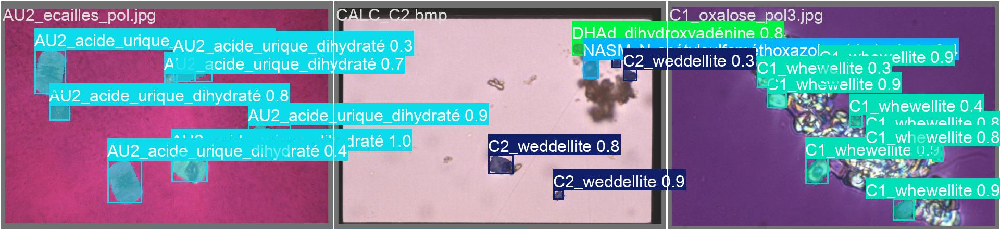

# Urinary crystal instance segmentation

I prepared microscopy images for instance segmentation and fine-tuned YOLO11 models to locate and identify individual urinary crystals. The work covers inconsistent filenames, mixed crystal species, expert polygon annotations and an imbalanced training dataset.

**Python · Ultralytics YOLO11 · NumPy · pandas · Pillow · Google Colab**

[Training notebook](notebooks/PRI_train.ipynb) · [Technical report](docs/reports/project-report.pdf) · [Recorded presentation · 2:17](docs/media/project-presentation.mp4)

| Dataset review | Evaluated model variant | Five-fold validation |
| --- | --- | --- |
| **659 source images** | **583 images · 15 classes** | **0.4874 ± 0.0453 mask mAP50–95** |

YOLO11m-seg, mean ± SD across five folds, using each fold's best validation epoch. [Protocol and per-fold results](docs/experiments.md).

## Segmentation examples

Three examples from the report's validation collage. The exact generating run is not recorded. [Visual sources and interpretation](docs/media-guide.md#prediction-collage).

View the full original prediction collage

[Figure 6.3 in the report](docs/reports/project-report.pdf#page=23) · [Project poster](docs/reports/project-poster.pdf)

## What I worked on

- **Data preprocessing and metadata:** matched images and labels, handled incompatible TIFFs, and extracted a 659-row table using species and abbreviation mappings. [Python script](scripts/preprocessing/data_preprocessing_image_metadata.py) · [CSV](metadata/image_metadata.csv)
- **Annotation preparation:** processed expert CVAT polygons, merged five class aliases and filtered sparse classes. [Class mapping and support](docs/data.md#annotations-and-class-mapping)
- **Deep learning:** fine-tuned pretrained YOLO11n-seg and YOLO11m-seg models at 1024 px, with separate dataset variants and augmentation settings. [Notebook guide](notebooks/README.md)
- **Evaluation:** built multilabel-stratified folds and analysed mask precision, recall and mAP across five validation folds. [Experiments and results](docs/experiments.md)

## Five-fold results

The 15-class experiment uses **583 images** and selects the highest validation mask mAP50–95 epoch within each fold. The earlier 19-class experiment uses a different dataset and result-selection rule. [Full protocol and limitations](docs/experiments.md).

All four mask metrics

| Precision | Recall | mAP50 | mAP50–95 |
| --- | --- | --- | --- |
| 0.7022 ± 0.0335 | 0.6306 ± 0.0513 | 0.6813 ± 0.0427 | **0.4874 ± 0.0453** |

Mean ± sample standard deviation across five validation folds.

## Project workflow

View data sources, preprocessing, both model variants and outputs

[Dataset and class distribution](docs/data.md) · [Environment and execution notes](docs/reproducibility.md)

## Presentation and poster

| Recorded presentation · 2:17 | Original poster · 1 page |
| :---: | :---: |
|  |  |

[Defence slides · 20 slides](docs/presentations/project-defence.pptx) · [All materials and reading guide](docs/media-guide.md)

Research and Innovation Project (PRI), completed during my Erasmus exchange at **Polytech Tours, Université de Tours**, in collaboration with **CHU Orléans**. Medical engineers at the hospital provided the manual annotations. [Project context and contributions](docs/project.md).
