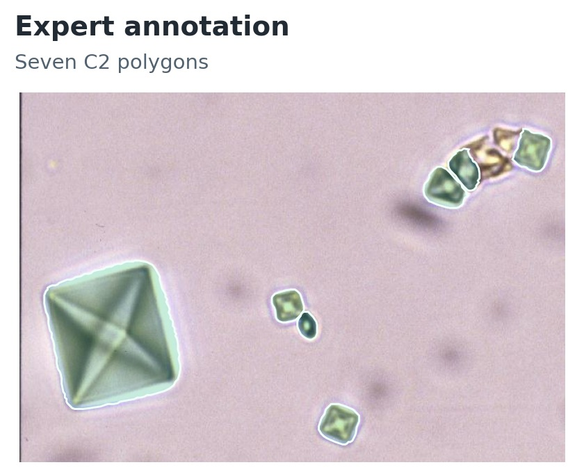
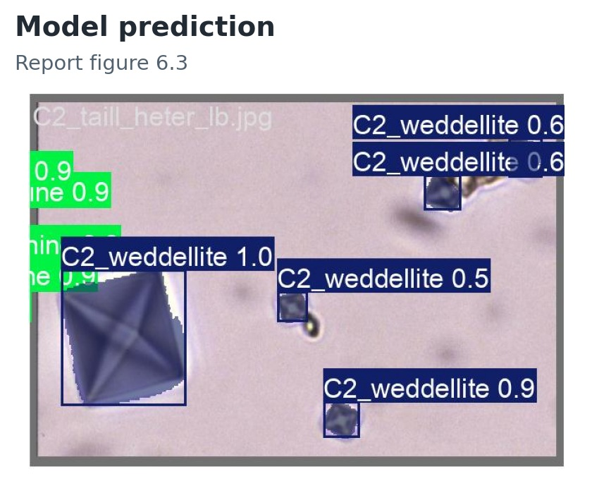
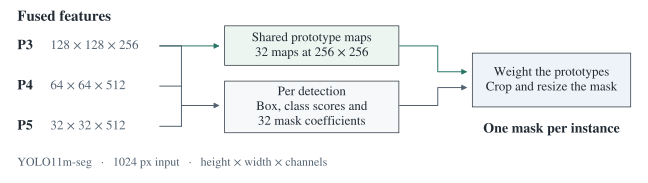
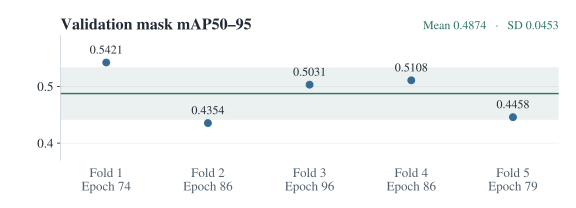

# Urinary crystal instance segmentation

A single microscopy image can contain several crystals, sometimes of different species. I fine-tuned YOLO11 segmentation models to outline each crystal and assign it a class. Medical engineers at CHU Orléans drew the polygons in CVAT. I matched those annotations to the images, resolved duplicate species labels and evaluated the models across five validation folds.

[Training notebook](notebooks/PRI_train.ipynb) · [Technical report](docs/reports/project-report.pdf)

## One microscopy field

Both panels show the same field of weddellite crystals. The expert marked **seven instances of C2**. In the report, the model labelled the large crystal on the left as C2 with a displayed confidence of 1.0. It gave a smaller crystal near the centre the same label with a confidence of 0.5.

The prediction is a crop of report Figure 6.3. The report does not identify its model, fold or checkpoint. [Original image and expert polygons](docs/data.md#annotation-example) · [Full prediction collage](docs/media-guide.md#prediction-collage).

## From expert polygons to training labels

I started with **659 source images** and a CVAT export with **41 class IDs**. Some IDs referred to the same species. For example, the export listed brushite under both `brushite` and `Br_brushite`. I merged five such aliases before counting how many images contained each class.

I used classes present in at least five labelled images for the first experiment. That left **607 images and 19 classes**. For the second, I removed four more classes, updated the polygon IDs and dropped images with no remaining annotations. The final set contained **583 images, 15 classes and 7,371 annotated instances**. [Preparation stages and class mapping](docs/data.md#preparation-stages).

| IDs 0–4 | IDs 5–9 | IDs 10–14 |
| --- | --- | --- |
| **AMO** · Amoxicillin trihydrate | **C3** · Caoxite | **NASM** · N-acetylsulfamethoxazole hydrochloride |
| **AU2** · Uric acid dihydrate | **CAL** · Calcite | **PACC** · Plaque vitreuse¹ |
| **Br** · Brushite | **CYS** · Cystine | **PAM** · Struvite |
| **C1** · Whewellite | **DHAd** · Dihydroxyadenine | **UrAm** · Anhydrous ammonium urate |
| **C2** · Weddellite | **NASD** · N&#8209;acetylsulfadiazine | **VAT** · Vaterite |

¹ Original training label. [Class IDs and counts by image and instance](docs/data.md#segmentation-classes).

I used the hospital’s coding guide to extract species and acquisition details from filenames into a 659-row metadata table. This helped me review the collection. Training used the images and expert polygons. [Metadata script](scripts/preprocessing/data_preprocessing_image_metadata.py) · [Image metadata](metadata/image_metadata.csv).

## How the model predicts a mask

YOLO11m-seg uses three feature scales to predict boxes and class scores. It also learns 32 shared mask patterns for the field. Each detection has its own set of 32 coefficients, so two crystals of the same class can have different outlines. [Full architecture and tensor dimensions](docs/architecture.md).

## Training and validation

I started each fold from pretrained Ultralytics weights. Because a field could contain several classes, I used multilabel stratification to split images according to all the classes present. [Notebook guide](notebooks/README.md).

| Model | Training set | Input and training budget | Epoch used in the summary |
| --- | --- | --- | --- |
| [YOLO11n-seg](docs/experiments.md#earlier-yolo11n-seg-result) | 607 images · 19 classes | 1024 px · batch 4 · up to 50 epochs | Last recorded epoch in each run directory |
| [YOLO11m-seg](docs/experiments.md#yolo11m-seg-per-fold-mask-metrics) | 583 images · 15 classes | 1024 px · batch 4 · up to 100 epochs | Highest validation mask mAP50–95 in each fold |

Across five folds, **YOLO11m-seg reached a mean validation mask mAP50–95 of 0.4874** (sample SD 0.0453). This metric averages per-class mask AP across classes and overlap thresholds from 0.50 to 0.95.

| Mask precision | Mask recall | Mask mAP50 | Mask mAP50–95 |
| --- | --- | --- | --- |
| 0.7022 ± 0.0335 | 0.6306 ± 0.0513 | 0.6813 ± 0.0427 | **0.4874 ± 0.0453** |

The folds were split by image. Related views of the same specimen could fall into different folds. The two experiments also used different class sets, augmentations and epoch-selection rules, which limits what their scores tell us about model size alone. [Per-fold metrics](docs/experiments.md#yolo11m-seg-per-fold-mask-metrics) · [Recorded CSV](results/recorded-fold-metrics.csv).

## Poster and presentation

| Recorded presentation · 2:17 | Project poster |
| :---: | :---: |
|  |  |

[Defence slides](docs/presentations/project-defence.pptx)

## Repository guide

| Resource | What you’ll find |
| --- | --- |
| [Notebook](notebooks/README.md) · [Execution notes](docs/reproducibility.md) | Colab preparation and training, saved outputs and paths to adapt before a rerun. |
| [Dataset](docs/data.md) · [Source export](data/README.md) · [Metadata](metadata/README.md) | Class counts, annotation format, split files and the filename fields. |
| [Architecture](docs/architecture.md) · [Experiments](docs/experiments.md) · [Result tables](results/README.md) | The segmentation head, training settings and how each fold score was selected. |
| [Project context](docs/project.md) · [Report and presentation materials](docs/media-guide.md) | My contribution at Polytech Tours, the hospital’s annotations and the original project deliverables. |

*Research and Innovation Project (PRI), Polytech Tours, Université de Tours, during my Erasmus exchange.*
