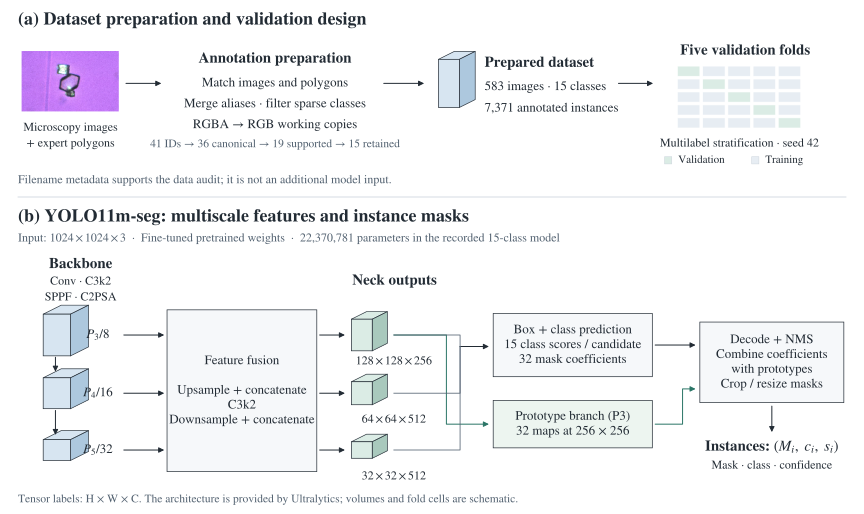
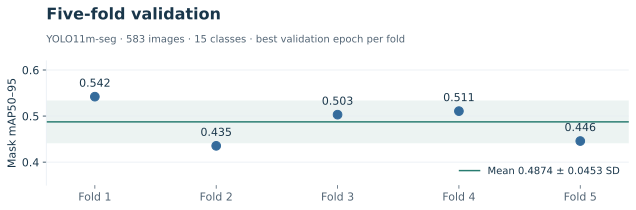
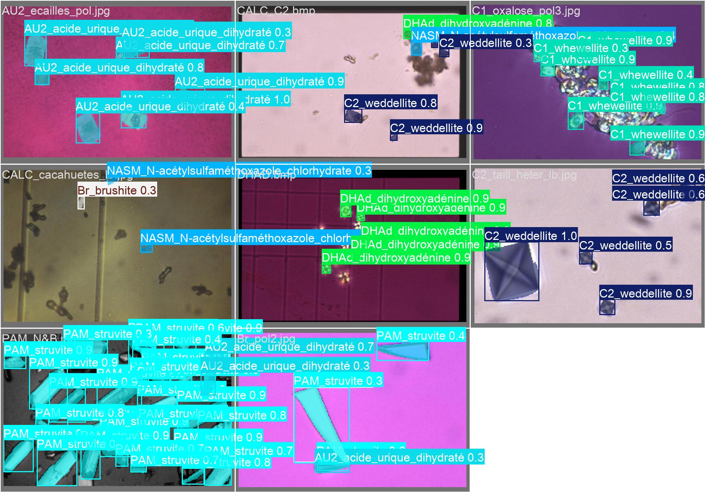
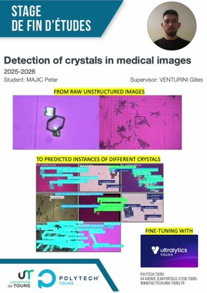
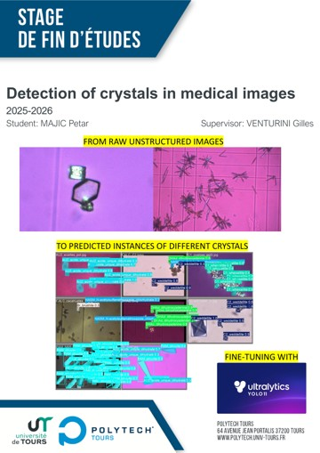

# Urinary crystal instance segmentation

Urinary crystal images can contain several species, while their filenames and folder labels are inconsistent. I prepared the microscopy data and fine-tuned YOLO11 models to locate and identify individual crystal instances using expert polygon annotations.

*Completed as part of the Research and Innovation Project (PRI) course during my Erasmus exchange at Polytech Tours, Université de Tours.*

**Python · Ultralytics YOLO11 · NumPy · pandas · Pillow · Google Colab**

[Training notebook](notebooks/PRI_train.ipynb) · [Technical report](docs/reports/project-report.pdf) · [Recorded presentation · 2:17](docs/media/project-presentation.mp4)

## Project workflow

The work connects dataset review, annotation preparation, model training and evaluation. Filename metadata supports the data review, while the images and expert polygons form the training input.

## What I worked on

- **Data preprocessing and metadata:** matched images and labels, handled incompatible TIFFs, and extracted a 659-row table using species and abbreviation mappings. [Python script](scripts/preprocessing/data_preprocessing_image_metadata.py) · [CSV](metadata/image_metadata.csv)
- **Annotation preparation:** processed expert CVAT polygons, merged five class aliases and filtered sparse classes. [Class mapping and support](docs/data.md#annotations-and-class-mapping)
- **Deep learning:** fine-tuned pretrained YOLO11n-seg and YOLO11m-seg models at 1024 px, with separate dataset variants and augmentation settings. [Notebook guide](notebooks/README.md)
- **Evaluation:** built multilabel-stratified folds and analysed mask precision, recall and mAP across five validation folds. [Experiments and results](docs/experiments.md)

The notebook records these steps and their saved outputs. The results below come from the 15-class YOLO11m-seg experiment.

## Five-fold results

**YOLO11m-seg · 583 images · 15 classes · 1024 px**

| Mask precision | Mask recall | Mask mAP50 | Mask mAP50–95 |
| --- | --- | --- | --- |
| 0.7022 ± 0.0335 | 0.6306 ± 0.0513 | 0.6813 ± 0.0427 | **0.4874 ± 0.0453** |

Mean ± sample standard deviation across five folds, using each fold's highest validation mask mAP50–95 epoch. The earlier 19-class experiment uses a different dataset and result-selection rule. [Full protocol, per-fold values and limitations](docs/experiments.md).

## Example predictions

The validation collage shows predicted instance masks, class labels and confidence scores across different microscopy images.

Original Figure 6.3 from the report. Its exact generating run is not recorded. [Visual sources and interpretation](docs/media-guide.md#prediction-collage).

## Code and documentation

| Start here | What it contains |
| --- | --- |
| [Training notebook](notebooks/PRI_train.ipynb) | Dataset preparation, class filtering, fold generation, training and saved outputs |
| [Preprocessing scripts](scripts/preprocessing/) | Metadata extraction, image/label filtering and the earlier split helpers |
| [Dataset guide](docs/data.md) | Source data, annotation format, class mappings and distribution |
| [Experiment guide](docs/experiments.md) | Training settings, per-fold metrics and interpretation of both experiments |
| [Execution notes](docs/reproducibility.md) | Recorded environment, historical paths and preparation for a new run |
| [Technical report](docs/reports/project-report.pdf) | Full project methodology and original figures |

## Presentation and poster

The poster, recorded presentation and defence slides explain the dataset difficulties, the preparation steps and the model experiments.

| Recorded presentation · 2:17 | Original poster · 1 page |
| :---: | :---: |
|  |  |

[Defence slides · 20 slides](docs/presentations/project-defence.pptx) · [All materials and reading guide](docs/media-guide.md)

The project involved **CHU Orléans**, whose medical engineers provided the manual annotations. [Project context and contributions](docs/project.md).
