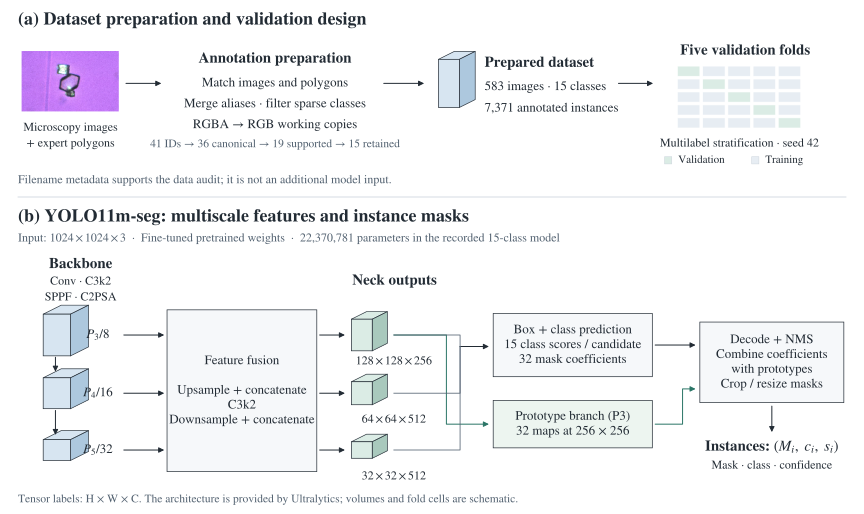

# Model and experimental design

I fine-tuned Ultralytics **YOLO11m-seg** from `yolo11m-seg.pt` to segment 15 classes. A crystal can share its class with several neighbours in the same field. To distinguish those instances, the model predicts a separate mask for each detection.

**Figure 1.** (a) Images and expert polygon annotations are prepared for five-fold validation. (b) The model combines multiscale feature maps with mask prototypes and instance-specific coefficients. Tensor labels use height × width × channels. The microscopy image illustrates the source collection; volumes and fold cells are schematic.

## Dataset preparation

I merged five aliases among the 41 source IDs, leaving 36 distinct class names. I kept classes present in at least five labelled images, which gave me 607 images and 19 classes for the first experiment. For the main experiment, I removed four more classes and dropped images with no remaining polygons. That left **583 images, 15 classes and 7,371 annotated instances**. [Class counts from cell 35](../metadata/derived/drop4-class-support.csv) · [Preparation stages](data.md#preparation-stages).

I also extracted filename metadata for 659 images to review mixtures, pH and acquisition conditions. The model takes the microscopy image as input. Its training targets come from the polygons that CHU Orléans medical engineers drew in CVAT.

## Feature extraction and fusion

For a **1024 × 1024** input, the feature maps have the dimensions below. I took the channel counts from the model summary in cell 37 and derived the spatial dimensions from the downsampling strides.

| Stage | Saved module / index | Feature shape, H × W × C |
| --- | --- | --- |
| Input | RGB image tensor | 1024 × 1024 × 3 |
| Backbone P3 | C3k2, layer 4 | 128 × 128 × 512 |
| Backbone P4 | C3k2, layer 6 | 64 × 64 × 512 |
| Backbone P5 | C3k2 → SPPF → C2PSA, layers 8–10 | 32 × 32 × 512 |
| Fused P3 | Upsample, concatenate, C3k2, layer 16 | **128 × 128 × 256** |
| Fused P4 | Downsample, concatenate, C3k2, layer 19 | **64 × 64 × 512** |
| Fused P5 | Downsample, concatenate, C3k2, layer 22 | **32 × 32 × 512** |

The backbone supplies features at strides 8, 16 and 32. The neck combines coarse and fine features through upsampling, concatenation and subsequent downsampling. All three fused outputs feed the `Segment` head, so the head can use features at different spatial resolutions.

The saved summary reports **254 layers and 22,370,781 parameters**, with **22,370,765 parameters used for gradient updates**. These counts apply after the original 80-class pretrained head was adapted to the 15 retained classes. [The extracted module table](../results/yolo11m-layer-summary.csv) preserves all 24 top-level module rows and their printed arguments.

## From features to instance masks

The recorded head arguments are `Segment[15, 32, 256, 16, None, [256, 512, 512]]`. The table shows how the head turns these features into an instance prediction.

| Head component | Meaning |
| --- | --- |
| `nc = 15` | Fifteen class-score outputs per candidate |
| `nm = 32` | Thirty-two instance-specific mask coefficients |
| Prototype branch | Reads the fused P3 tensor; outputs 32 prototype maps |
| Prototype spatial size | 256 × 256 for the nominal 1024 × 1024 input, after the prototype module's 2× upsampling |
| Detection outputs | Decoded bounding boxes and class scores, followed by non-maximum suppression |
| Final segmentation output | One mask, class label and confidence score per retained instance |

For instance *i*, the mask logit map is a learned linear combination of the prototype maps:

$$L_i(u,v)=\sum_{j=1}^{32} a_{ij}P_j(u,v).$$

Here, `a` denotes instance-specific mask coefficients and `P` the shared prototype maps. Postprocessing crops and resizes masks using the detected boxes. Ultralytics implements the reconstruction and postprocessing.

## Validation design

The notebook records which of the 15 classes appears in each image as a binary **583 × 15** matrix. It then applies `MultilabelStratifiedKFold(n_splits=5, shuffle=True, random_state=42)`. Multilabel stratification accounts for images containing more than one class when assigning them to folds.

I started each fold independently from pretrained YOLO11m-seg weights. I used a batch size of 4, trained for up to 100 epochs and set early-stopping patience to 20. For each fold I reported the epoch with the highest validation mask mAP50–95.

[Actual fold sizes](data.md#trainvalidation-strategy) · [Training arguments and selected epochs](experiments.md)

## Sources

- **Project notebook:** notebook cells 29–38, including the printed model summary in cell 37.
- **Versioned architecture:** [Ultralytics 8.4.14 YOLO11 segmentation YAML](https://github.com/ultralytics/ultralytics/blob/v8.4.14/ultralytics/cfg/models/11/yolo11-seg.yaml).
- **Head implementation:** [Segment](https://github.com/ultralytics/ultralytics/blob/v8.4.14/ultralytics/nn/modules/head.py) and [Proto](https://github.com/ultralytics/ultralytics/blob/v8.4.14/ultralytics/nn/modules/block.py).
- **Microscopy illustration:** unchanged embedded image from the original project poster; see [asset sources](../assets/README.md).

[Back to project overview](../README.md)
