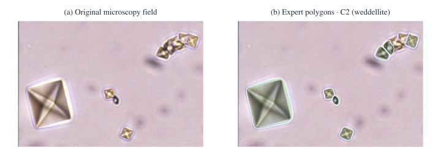
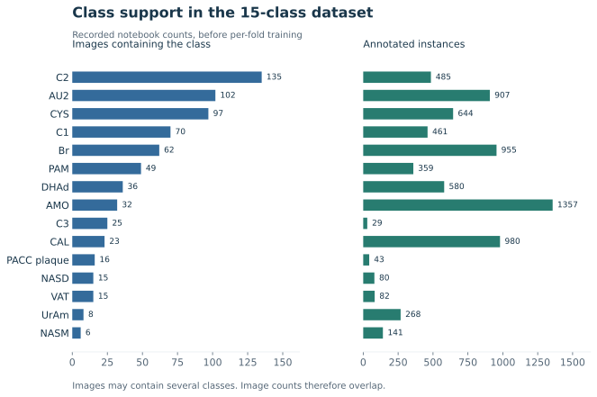

# Dataset and preprocessing

## Source collection

CHU Orléans medical experts supplied microscopy images with species codes and acquisition clues in their filenames. The original collection contains **659 images**. Images differ in resolution, lighting and crystal shape. Some contain several species. The initial [dataset review](domain-notes/initial-dataset-review-fr.docx) explains why a directory name cannot be used directly as a complete label.

The [metadata CSV](../metadata/image_metadata.csv) records image names, paths, species inferred from filenames, mixtures, abbreviations and pH. [The field guide](../metadata/README.md) explains how each field was extracted and how it differs from an expert annotation.

## Preparation stages

| Stage | Recorded count | Source |
| --- | --- | --- |
| Source image collection | 659 images | Metadata CSV; report Chapter 4 |
| Early random split | 490 train + 123 validation + 46 unannotated | Preserved dataset split lists |
| Later notebook matching | 612 labeled image stems | Notebook cells 3/6/10; report §6.1 |
| After alias merging and support filtering | 607 usable images, 19 classes, 7,492 retained instances | Notebook cell 10 |
| After dropping four classes and images with no remaining annotations | 583 images, 15 classes | Notebook cells 29–36 |

The early split accounts for 613 labeled images, while the later notebook matching stage counts 612. The notebook matches by filename stem and applies its own filtering. The one-image difference between these recorded stages remains unresolved.

## Annotations and class mapping

Medical engineers performed manual annotation in **CVAT**, then exported **Ultralytics YOLO Segmentation 1.0** labels. Each `.txt` line describes one instance:

```text
class_id x1 y1 x2 y2 ... xn yn
```

Coordinates are normalised polygon vertices. An image may contain multiple instances and multiple class IDs. These labels support instance segmentation rather than just one image-level category.

The source [`data.yaml`](../data/annotated/data.yaml) contains 41 class IDs. Notebook cell 6 merges five aliases:

| Original ID/name | Mapped label |
| --- | --- |
| 0 / brushite | 13 / Br_brushite |
| 1 / calcite | 17 / CAL_calcite |
| 2 / caoxite | 16 / C3_caoxite |
| 3 / cystine | 22 / CYS_cystine |
| 4 / dihydroxyadénine | 23 / DHAd_dihydroxyadénine |

This gives 36 class names. The notebook keeps classes present in at least five labelled images, producing the 19-class experiment. The 15-class variant additionally removes `ATZ_atazanavir`, `Cylindre`, `CEF_ceftriaxonate_de_calcium` and `CHOL_cholestérol`. Class IDs are remapped separately for each derived dataset. The source annotations remain unchanged in this repository.

## Segmentation classes

The following table follows the remapped IDs in notebook cell 35. English display names are provided for readability; the original training strings remain in the [source CSV](../metadata/derived/drop4-class-support.csv). Counts describe the prepared 15-class dataset, before fold splitting.

| ID | Code | Display name | Images | Instances |
| --- | --- | --- | ---: | ---: |
| 0 | AMO | Amoxicillin trihydrate | 32 | 1,357 |
| 1 | AU2 | Uric acid dihydrate | 102 | 907 |
| 2 | Br | Brushite | 62 | 955 |
| 3 | C1 | Whewellite | 70 | 461 |
| 4 | C2 | Weddellite | 135 | 485 |
| 5 | C3 | Caoxite | 25 | 29 |
| 6 | CAL | Calcite | 23 | 980 |
| 7 | CYS | Cystine | 97 | 644 |
| 8 | DHAd | Dihydroxyadenine | 36 | 580 |
| 9 | NASD | N-acetylsulfadiazine | 15 | 80 |
| 10 | NASM | N-acetylsulfamethoxazole hydrochloride | 6 | 141 |
| 11 | PACC | Plaque vitreuse (original wording) | 16 | 43 |
| 12 | PAM | Struvite | 49 | 359 |
| 13 | UrAm | Anhydrous ammonium urate | 8 | 268 |
| 14 | VAT | Vaterite | 15 | 82 |

The instance counts sum to **7,371**. Image counts overlap because an image can contain more than one class. `PACC_Plaque_vitreuse` remains a source training category; no additional clinical interpretation is assigned to it. These labels identify annotated objects, rather than assigning one class to the entire microscopy image.

## Annotation example



The field is `C2_taill_heter_lb.jpg` from `data/annotated/images/train/cristaux_01/Database/weddellite octaedrique/`. The matching `.txt` file under `data/annotated/labels/train/` contains seven polygons, all assigned source ID **15 / C2_weddellite**. That source ID maps to **4** in the retained 15-class vocabulary.

The figure draws every polygon from this label file after scaling its normalised vertices to the source image dimensions. It shows expert annotations; model predictions are available separately. [Full source vocabulary](../data/annotated/data.yaml) · [Recorded model predictions](media-guide.md#prediction-collage).

## Images and objects per class



Source: saved notebook cell 35, also available as [CSV](../metadata/derived/drop4-class-support.csv). Image counts overlap because an image can contain several species. Instance counts give the number of annotated crystals. For example, CAL has 980 instances in 23 images, while C2 has 485 instances in 135 images. A large number of objects therefore does not necessarily mean that a class has many different images.

The figure uses the original source codes. The full species names are in the CSV and [domain coding guide](domain-notes/crystal-coding-guide-fr.docx). `PACC_Plaque_vitreuse` is retained as the original training label, without reinterpreting its clinical meaning.

## Image compatibility and matching

Notebook cells 22–23 inspect TIFF image modes and convert two RGBA images to RGB in the cleaned working copy, after making backups there. The conversions apply to the working dataset. Other preparation steps remove unusable annotations and update the class IDs of the remaining labels.

Some notebook stages match images and labels by filename stem. The source review describes related crops and different lighting views of a sample; patient or specimen grouping is not available for the reported image-level folds.

The export contains 659 images and 612 nonempty label files. The [data layout](../data/README.md) documents its source splits and filename encoding.

## Train/validation strategy

The early helper scripts perform random 80/20 splitting with seed 42. The later notebook constructs a binary vector of class presence per image and uses `MultilabelStratifiedKFold(n_splits=5, shuffle=True, random_state=42)`.

Each fold holds out one subset for validation. Fold sizes in the 15-class experiment are **469/114, 463/120, 466/117, 467/116 and 467/116** for train/validation. These are the splits associated with the main reported results. They are distinct from the original random split files.

The source file named `test_split.txt` contains unannotated images. It cannot provide ground-truth test metrics. [Experiment interpretation](experiments.md) and [data layout](../data/README.md) explain the distinction.
