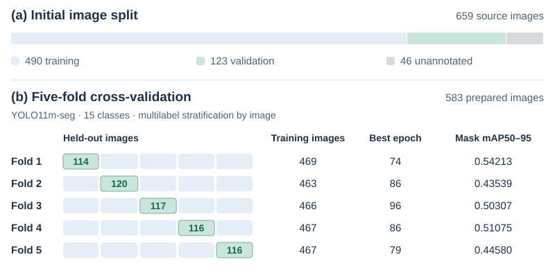

# Experiments and recorded results

## Reported experiment

I ran five-fold validation for two YOLO11 segmentation models. For the **15-class YOLO11m-seg experiment**, I selected the epoch with the highest validation mask mAP50–95 in each fold and summarised the five selected rows using their mean and sample standard deviation. The held-out images in each fold therefore served both to select the epoch and to report its score.

Cell 38 of the [training notebook](../notebooks/PRI_train.ipynb) contains the saved summary. The [fold metrics CSV](../results/recorded-fold-metrics.csv) also records the earlier experiment’s selection rule.

## Protocols

| Setting | Earlier experiment | 15-class experiment |
| --- | --- | --- |
| Initial model weights | `yolo11n-seg.pt` | `yolo11m-seg.pt` |
| Prepared dataset | `dataset_clean` | `dataset_clean_drop4` |
| Images / classes | 607 / 19 | 583 / 15 |
| Input size | 1024 | 1024 |
| Batch size | 4 | 4 |
| Maximum epochs | 50 | 100 |
| Early-stopping patience | 10 | 20 |
| Fold strategy | 5-fold multilabel stratification | 5-fold multilabel stratification |
| Split seed | 42 | 42 |
| Saved summary rule | Last CSV row in discovered `fold*` directories | Best validation mask mAP50–95 row in each of `fold_1` to `fold_5` |
| Source cells | 24, 26–27 | 29–38 |

The 15-class variant removes four labels and any image left without a retained instance. Its training call sets `degrees=15`, `translate=0.10`, `scale=0.50`, `fliplr=0.5`, `flipud=0.5`, `mosaic=0`, `mixup=0`, `hsv_h=0.01`, `hsv_s=0.10`, `hsv_v=0.10` and `workers=0`. Other settings follow the installed library's behaviour. The split seed is distinct from the trainer seed; saved trainer output records `seed=0`.

For the earlier experiment, I disabled augmentation in the attempt in cell 20. The run that completed in cell 24 used defaults including `mosaic=1.0`, `fliplr=0.5` and `scale=0.5`. The saved summary includes the retry directory `fold_116`.

The local [`train_yolo.py`](../scripts/training/train_yolo.py) and [`hyp.yaml`](../configs/hyp.yaml) describe a **separate 640 px setup**. Both experiments in the table used the 1024 px notebook configuration.

## YOLO11m-seg: per-fold mask metrics

| Fold | Selected epoch | Precision | Recall | mAP50 | mAP50–95 |
| --- | --- | --- | --- | --- | --- |
| 1 | 74 | 0.70804 | 0.70550 | 0.74196 | 0.54213 |
| 2 | 86 | 0.72261 | 0.57173 | 0.63074 | 0.43539 |
| 3 | 96 | 0.70589 | 0.65048 | 0.69201 | 0.50307 |
| 4 | 86 | 0.72940 | 0.62664 | 0.68972 | 0.51075 |
| 5 | 79 | 0.64486 | 0.59843 | 0.65183 | 0.44580 |
| **Mean ± SD** | — | **0.7022 ± 0.0335** | **0.6306 ± 0.0513** | **0.6813 ± 0.0427** | **0.4874 ± 0.0453** |

**Figure 1.** Initial image split (a) and five-fold validation on the 15-class dataset (b). The epoch and mask mAP50–95 refer to the same selected row in each fold’s training log.

Fold 2 had the lowest selected score (0.43539 at epoch 86) and fold 1 the highest (0.54213 at epoch 74). The SD in the table describes the variation across the five selected scores.

## Earlier YOLO11n-seg result

| Recorded directory | Mask precision | Mask recall | Mask mAP50 | Mask mAP50–95 |
| --- | --- | --- | --- | --- |
| `fold_116` | 0.61371 | 0.56273 | 0.57343 | 0.41634 |
| `fold_2` | 0.67119 | 0.67146 | 0.66148 | 0.46970 |
| `fold_3` | 0.57843 | 0.51078 | 0.54918 | 0.37283 |
| `fold_4` | 0.64063 | 0.56732 | 0.58160 | 0.40381 |
| `fold_5` | 0.51591 | 0.49205 | 0.50193 | 0.35498 |
| **Mean ± SD** | **0.6040 ± 0.0599** | **0.5609 ± 0.0699** | **0.5735 ± 0.0581** | **0.4035 ± 0.0443** |

For YOLO11n-seg I used the **last recorded epoch** in each listed directory, as shown in cell 26.

## What the metrics measure

- **Mask precision / recall:** precision measures how many predicted instances match ground truth under the evaluator’s matching rule. Recall measures how many annotated instances those predictions recover.
- **Mask mAP50:** mean average precision for masks at IoU 0.50.
- **Mask mAP50–95:** mean average precision for masks across IoU thresholds 0.50 to 0.95 in steps of 0.05.

I used the Ultralytics mask columns marked `(M)`. The columns marked `(B)` score bounding boxes. A confidence score on a prediction belongs to that detection.

## Interpretation and limitations

The later experiment had higher recorded mask scores. I also changed the image set, retained classes, augmentation, training budget and epoch-selection rule. These runs cannot establish how much of the difference came from changing the model size.

I split by image, using the classes present in each field. The source review describes crops and different lighting views of the same sample. Without patient, specimen or session grouping, related images could appear on both sides of a fold.

The report's confusion matrices and prediction collage show individual model outputs, but the figure files do not identify the checkpoints that produced them. The report also notes a negative entry in an earlier normalised confusion matrix. That matrix is excluded from the quantitative summaries.

The images in `test_split.txt` have no annotations, so they cannot be used to calculate test metrics. The project does not include an independent external or clinical test. Some species also have far fewer labelled images than others, so the overall scores should be read alongside the [image and instance counts](data.md#images-and-objects-per-class).

## Experiment files

| File or material | Available here |
| --- | --- |
| Notebook code and saved training logs | [Original notebook](../notebooks/PRI_train.ipynb) |
| Recorded fold summary values | [CSV](../results/recorded-fold-metrics.csv) |
| Written methodology and original figures | [Report](reports/project-report.pdf), Chapter 6 |
| Per-epoch run CSVs / exported model checkpoints | Not included as separate files |
| Original run ZIP | Its export log is saved in notebook cell 39; the ZIP itself is not included |
