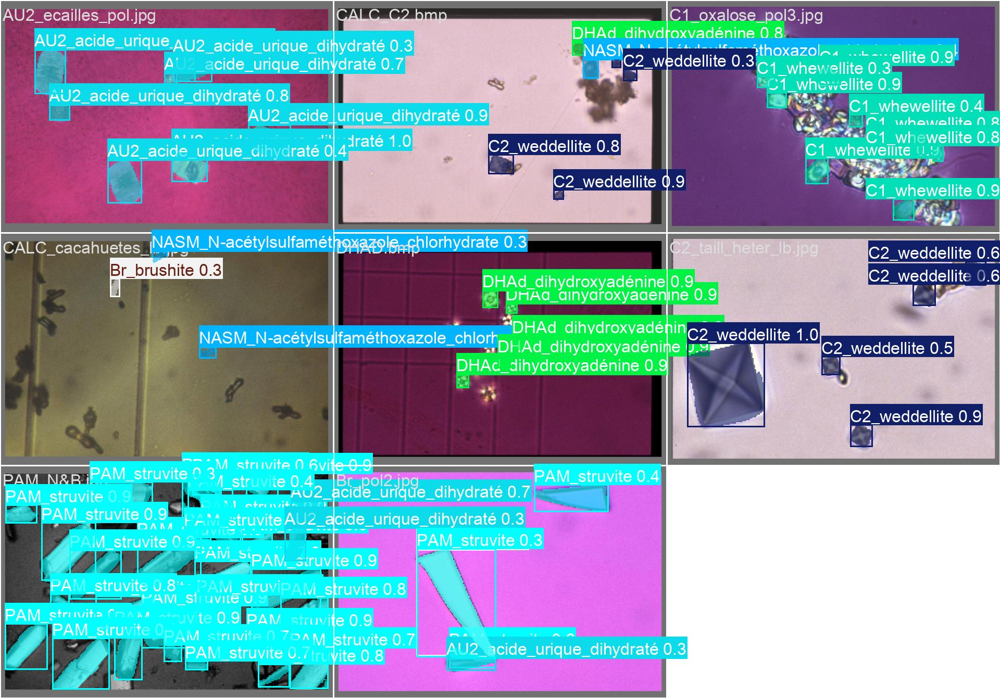
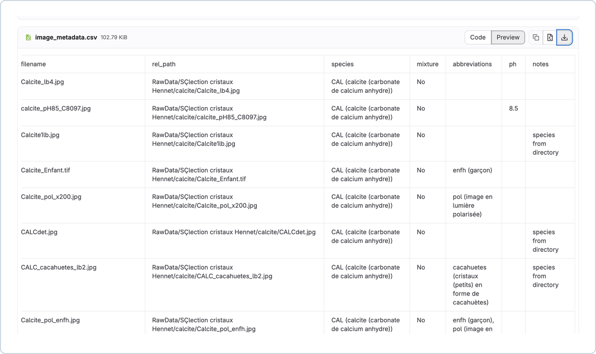
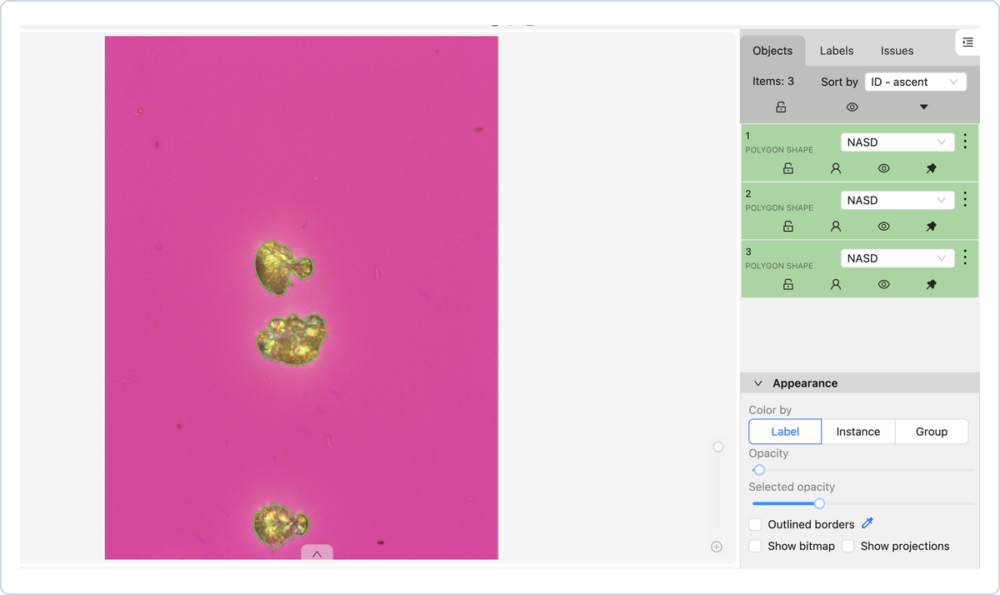

# Project materials and visual evidence

## Where to start

| Material | Format | What it explains |
| --- | --- | --- |
| [Recorded presentation](media/project-presentation.mp4) | Video, 2 min 17 s, approximately 44.5 MB | Petar's recorded presentation alongside the project poster |
| [Poster](reports/project-poster.pdf) | 1-page PDF | Source image examples and a collage of predicted crystal instances |
| [Project defence](presentations/project-defence.pptx) | 20 slides | Metadata, dataset difficulties, CVAT annotation, fold preparation and results |
| [Technical report](reports/project-report.pdf) | 24-page PDF | Detailed methodology, domain terminology, experiment settings and discussion |
| [Training workflow](presentations/training-workflow.pptx) | 8 slides | Earlier workflow exploration, export format, augmentation options and references |
| [Training and validation](presentations/train-and-validation.pptx) | 7 slides | Earlier random split, class imbalance questions and consideration of stratification/K-fold |

The poster and video provide a short introduction. The notebook and report provide the technical evidence. The earlier planning slides document how the approach developed; proposed options in those slides are not evidence that every option was implemented.

## Prediction collage

[Open Figure 6.3 in the original report](reports/project-report.pdf#page=23) · [Open the poster](reports/project-poster.pdf)

This is the embedded image from **report Figure 6.3, PDF page 23**. The poster also includes the same collage. It shows model-predicted instances, class labels and confidence scores across several validation images. Dense scenes, different appearances and crowded labels are visible.

The README shows a separate paired microscopy/annotation figure drawn from the source image and expert polygons. This original prediction collage remains available here and in the report. A [top-row excerpt](../assets/prediction-overview.jpg) is also available for closer inspection.

The collage is a qualitative example. It has no paired ground-truth panel and its exact model/fold/checkpoint is not identified by the figure. It should therefore be interpreted separately from the main five-fold metric plot. The original masks, labels and confidence values are preserved in the report and poster.

## Poster and recording

[Open the original poster PDF](reports/project-poster.pdf) · [Open the recorded presentation](media/project-presentation.mp4)

The poster contrasts two raw microscopy examples with the prediction collage and identifies the student and supervisor. Its portrait format and dense collage are best inspected in the full PDF. The README links directly to the poster and report figure.

The video is a **recorded poster presentation**, with the speaker visible in a small circular inset. The visual content remains the poster throughout the sampled timeline. It is not a live inference demonstration. The video retains its original audio and file contents. The visual review sampled frames at five-second intervals; the narration has not been transcribed or used as the source of metric claims. The report and notebook provide those claims.

## Defence: the technical sequence

[Open the full defence presentation · 20 slides](presentations/project-defence.pptx)

| Slides | Focus | Best companion |
| --- | --- | --- |
| 1–4 | Project, objectives, tools and phases | [Project context](project.md) |
| 5–9 | Metadata CSV, unreliable folders, mixed species and acquisition variability | [Dataset guide](data.md) |
| 10–11 | CVAT project and polygon annotations | Report Chapter 5; medical engineers performed the manual annotations |
| 12–15 | Label availability, filtering, class support and folds | [Dataset stages](data.md#preparation-stages) |
| 16–20 | Training calls, confusion matrices and experiment summaries | [Experiment protocols](experiments.md) |

### Metadata and annotation evidence

| Structured metadata | Expert polygon annotations |
| :---: | :---: |
|  |  |
| [CSV](../metadata/image_metadata.csv) · [Extraction script](../scripts/preprocessing/data_preprocessing_image_metadata.py) | [Annotation format and class mapping](data.md#annotations-and-class-mapping) |

Excerpts from defence slides **5 and 11**, with a consistent frame and scale. Click either image for the larger view. The CSV records the preprocessing output. The CVAT view shows the hospital experts' manual annotations used as training input.

### Fold preparation

Defence slide **15** records the earlier **607-image, 19-class stage**:

| Fold | Training images | Validation images |
| --- | --- | --- |
| 1 | 489 | 118 |
| 2 | 483 | 124 |
| 3 | 487 | 120 |
| 4 | 481 | 126 |
| 5 | 488 | 119 |

The main README reports the later 583-image, 15-class experiment. Its fold sizes and results are documented in the [dataset guide](data.md#trainvalidation-strategy) and [experiment guide](experiments.md).

### Original defence slides

[Full presentation · 20 slides](presentations/project-defence.pptx)

Individual source previews: [cover](../assets/defence-preview.jpg) · [metadata, slide 5](../assets/metadata-slide.jpg) · [annotations, slide 11](../assets/annotation-slide.jpg) · [fold preparation, slide 15](../assets/folds-slide.jpg).

The original previews retain the presentation's typography and blue headers. The framed excerpts and native table above provide the focused technical view.

## Earlier slides and source references

`train-and-validation.pptx` discusses a random split with 613 labeled and 46 unannotated images. One diagram labels the validation size as 113, while the preserved `val_split.txt` has **123 entries**, consistent with 613−490. The source slides remain unchanged; the dataset guide uses the verified list count.

`training-workflow.pptx` includes an external YOLOv9 medical-segmentation workflow reference and a model comparison screenshot from documentation. Those are background references, not results of this project. The saved training notebook establishes YOLO11n-seg and YOLO11m-seg as the models used for the reported experiments. Copy-paste augmentation appears as an earlier option; it should not be attributed to the later experiment's explicit training call.

## Confusion matrices

[Open Figure 6.2 in the original report](reports/project-report.pdf#page=22).

Original Figure 6.2, PDF page 22. These plots provide additional qualitative context. The source figure does not identify a checkpoint sufficiently to pair it with a specific selected-epoch CSV row. Aggregate results come from the notebook summary. For the earlier normalised matrix, the report itself flags a negative entry as an artifact. No numeric matrix has been reconstructed from these screenshots.

[Chart provenance](../assets/README.md) lists the sources of the derived graphs. The original visual deliverables remain linked above.
